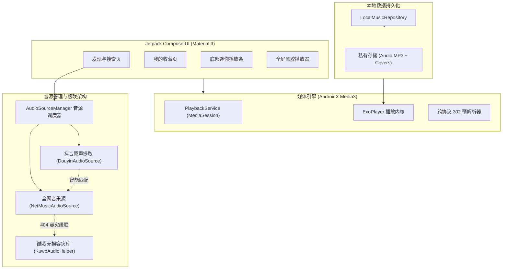

# 🎵 Android 原生个人音乐播放器 (MusicApp)

一款专为个人打造、**零云端服务器依赖**、具有极致原生质感的 Android 音乐播放器应用。

支持**全网热歌搜索、高清封面匹配、抖音短视频/口令一键提取原声音轨、多音源自动容灾级联、本地持久化离线畅听**以及现代 Android 系统级媒体控制。

---

## 🌟 核心特性

- 📱 **纯原生现代体验**：全面采用 Kotlin + Jetpack Compose + Material 3 架构，适配 Android 14/15/16/17 全面屏边到边设计与动态取色。
- 🔍 **全网音源无损聚合**：一键搜索歌曲、网络热歌、DJ 混音剪辑，实时解析无损/高清 MP3 音轨，每首歌配备 400x400 高清专辑封面。
- 🎬 **抖音短视频原声一键提取**：
  - 智能剪贴板监听：在抖音点击「分享 -> 复制链接」，打开音乐 App 自动识别并秒级提取无水印音频。
  - 支持从系统原生分享菜单「分享到 原生音乐」一键唤起。
  - 动态 `ttwid` 会话凭证 + `_ROUTER_DATA` 深入解析，无惧风控反爬。
- 🔄 **智能多音源自动级联容灾**：
  - 首选音源遇版权限制或 404 时，毫秒级无缝自动级联至酷我无损音源库，绝不报错中断。
- 💾 **全自动本地离线持久化**：
  - 点击爱心收藏或播放时，自动在后台持久化缓存 MP3 音轨与封面图。
  - 即使脱网、抖音原视频下架或链接失效，收藏列表依然可以永久离线播放。
- 🎧 **系统级媒体服务 (AndroidX Media3)**：
  - 后台常驻保活，锁屏大图控制，系统通知栏播放/暂停/切歌与进度条拖拽。
  - 蓝牙耳机双击切歌，拔出耳机自动暂停。
- 💿 **双模播放界面**：
  - 底部吸附式 **Mini 播放条**（微型黑胶慢速旋转 + 实时进度线）。
  - 上滑展开 **全屏黑胶播放器**（黑胶唱片质感动效、单曲循环/列表循环/随机播放模式切换）。

---

## 🏗️ 架构与技术栈



- **开发语言**：Kotlin 1.9.23
- **编译环境**：Java 17 + Android SDK 34 (Build-Tools 34.0.0) + Gradle 8.6
- **UI 框架**：Jetpack Compose BOM 2024.04.01 + Material 3
- **播放核心**：`androidx.media3:media3-exoplayer:1.3.1` + `media3-session:1.3.1`
- **网络框架**：OkHttp 4.12.0 + Gson 2.10.1
- **图片加载**：Coil Compose 2.6.0

---

## 🛠️ 项目结构

```text
music-app/
├── app/
│   ├── src/main/java/com/personal/musicapp/
│   │   ├── data/
│   │   │   ├── model/Song.kt                   # 歌曲数据模型
│   │   │   ├── local/LocalMusicRepository.kt    # 本地文件与收藏持久化
│   │   │   └── source/
│   │   │       ├── AudioSource.kt              # 音源抽象接口
│   │   │       ├── AudioSourceManager.kt       # 统一音源分发调度
│   │   │       ├── NetMusicAudioSource.kt      # 全网热歌与高清封面源
│   │   │       ├── KuwoAudioHelper.kt          # 酷我无损容灾音源库
│   │   │       └── DouyinAudioSource.kt        # 抖音口令与链接逆向解析引擎
│   │   ├── player/
│   │   │   ├── MusicPlayerManager.kt           # ExoPlayer 封装与 302 嗅探
│   │   │   ├── PlayerState.kt                  # 响应式播放状态
│   │   │   └── PlaybackMode.kt                 # 循环/单曲/随机模式
│   │   ├── service/PlaybackService.kt          # 系统级 MediaSession 前台服务
│   │   └── ui/                                 # Jetpack Compose 界面与动效
│   └── src/test/java/com/personal/musicapp/
│       └── AudioSourceTest.kt                  # 电脑端全真接口单元测试
├── docs/
│   └── DEVELOPMENT_PITFALLS_AND_SOLUTIONS.md   # 详细开发实战与排错笔记
├── install-to-phone.ps1                        # 一键真机推流安装脚本
├── view-phone-logcat.ps1                       # 一键实时查看真机彩色日志
└── music-app.apk                               # 编译完成的独立安装包
```

---

## 🚀 编译与真机运行

### 1. 电脑本地接口自动化验证
在打包前可直接在电脑上测试全网搜索、封面获取与音频直链解析：
```powershell
.\gradlew.bat testDebugUnitTest --console=plain
```

### 2. 命令行打包 APK
```powershell
.\gradlew.bat assembleDebug --console=plain
```
编译产物将自动生成于 `app/build/outputs/apk/debug/app-debug.apk`，并同步更新到根目录的 `music-app.apk`。

### 3. 一键真机推流安装
手机开启「USB 调试」并通过数据线连接电脑后，直接运行：
```powershell
.\install-to-phone.ps1
```

### 4. 实时查看真机日志
```powershell
.\view-phone-logcat.ps1
```

---

## 📖 踩坑与排错实战笔记

关于开发过程中遇到的抖音接口反爬、ExoPlayer 跨协议重定向拦截、3003 容器解析错误等详细排查过程，请参阅：
👉 **[开发踩坑与排错全记录 (DEVELOPMENT_PITFALLS_AND_SOLUTIONS.md)](file:///C:/code/music-app/docs/DEVELOPMENT_PITFALLS_AND_SOLUTIONS.md)**
