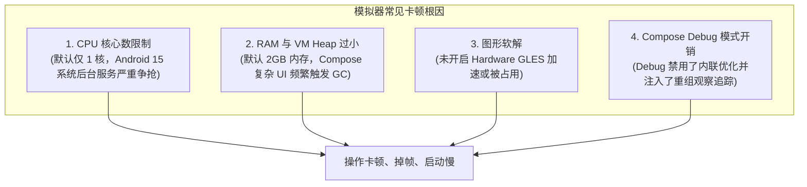

# 📱 Android Studio 模拟器 (AVD) 全景技术指南与实战手册

---

## 1. 核心概念速查

### 1.1 什么是 AVD？
**AVD (Android Virtual Device)** 本质是一个由 **QEMU 虚拟机引擎** 驱动的 Android 实例。它由三部分组合构成：
1. **硬件定义文件 (`config.ini`)**：定义屏幕分辨率、DPI、CPU 核心数、RAM 大小、传感器等。
2. **系统镜像 (System Image)**：底层只读操作系统分区（ROM），位于 `~/Library/Android/sdk/system-images/`。
3. **用户数据镜像 (`userdata.img`)**：可写数据分区，用户安装的 App、数据和缓存均保存在这里。

---

### 1.2 关键架构与名词

| 名词 | 作用与含义 | Mac Apple Silicon (M1/M2/M3) 必记军规 |
| :--- | :--- | :--- |
| **ABI (架构)** | 模拟器指令集架构（`arm64-v8a` 或 `x86_64`） | **必须选择 `arm64-v8a`**！因 M 系列芯片原生就是 ARM 架构，指令直通宿主机，接近真机性能。若误选 `x86_64` 会强制走 QEMU 软件转译，CPU 满载且极其卡顿。 |
| **API Level** | Android 系统版本（如 API 34 为 Android 14，API 35 为 Android 15） | 建议根据项目 `targetSdk` 选择相同或略低一级的稳定版本。 |
| **Target 标签** | 镜像类型：`Google APIs` / `Google Play` / `AOSP` | **Google Play** 镜像包含官方商店服务但禁止获取 Root 权限；**Google APIs** 允许 `adb root` 便于深度逆向与系统调试。 |
| **Graphics** | 图形渲染加速模式 | **Hardware (Host)**：直接利用 Mac 显卡通过 Metal 硬件渲染；**Software**：CPU 模拟渲染（会导致严重掉帧与发热）。 |

---

## 2. 为什么模拟器会卡？四大性能根因分析

1. **默认单核瓶颈 (`hw.cpu.ncore = 1`)**：Android Studio 新建设备时为兼容老电脑常默认分配 1 核，现代 Android 系统后台有大量系统服务，单核下主线程与渲染线程极易互斥排队。
2. **内存不足与频繁 GC**：Android 15 空载占用即超 1.2GB，若仅分配 2GB，只要打开一个稍大或含高分辨率图片的 App，就会频繁触发底层垃圾回收（Stop-the-world）。
3. **Compose 运行期机制**：Jetpack Compose 在 Debug 编译期未开启 R8 代码优化与函数内联，在没有真实 GPU 边际调度的虚拟层下，重组开销相比 Release 包放大 3~5 倍。

---

## 3. IDE 常用操作与运维指南

### 3.1 常用操作矩阵

| 动作 | 操作路径 | 典型使用场景 |
| :--- | :--- | :--- |
| **新建设备 (Create Device)** | `Device Manager` → `+` (Create Virtual Device) | 误删设备、新增机型或需要测试不同系统版本时。 |
| **冷启动 (Cold Boot Now)** | 设备右侧 `···` 菜单 → `Cold Boot Now` | 模拟器白屏、卡死、状态错乱，放弃内存快照从零完全引导。 |
| **抹掉数据 (Wipe Data)** | 设备右侧 `···` 菜单 → `Wipe Data` | 测试 App 全新安装环境、解决磁盘爆满或残留配置冲突。 |
| **嵌入式 / 独立窗口切换** | `Settings` → `Tools` → `Emulator` → 勾选/取消 `Launch in a tool window` | 习惯在代码右侧分屏看用嵌入式；双屏或大屏开发建议取消勾选切为独立浮窗。 |

---

## 4. 推荐硬件配置黄金模板（Apple Silicon 专属）

在新建或编辑设备时，点击 **Show Advanced Settings**，按以下参数配置以获得极致流畅体验：

- **CPU Cores**: `4`（占用 M2 核心的一部分，兼顾宿主机与虚拟机）
- **RAM**: `4096 MB` (4 GB)
- **VM heap**: `512 MB`
- **Internal Storage**: `6144 MB` (6 GB)
- **Graphics**: `Automatic` 或 `Hardware - GLES 2.0`
- **Boot Option**: `Quick boot`（日常秒开）
