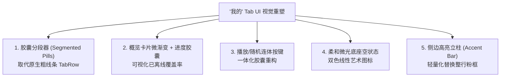

# 音乐客户端 UI / UX 体验改进建议汇总

本文件整理并归纳了针对当前音乐客户端（Personal Music App）在用户交互（UX）、界面设计（UI）、图标（Icon）、按钮（Button）以及「我的」页面的系统性体验优化建议，所有建议严格立足于现有业务功能范围内，旨在对标网易云音乐、Spotify、Apple Music 等成熟流媒体客户端的交互与视觉质感。

---

## 目录
- [一、已实施的功能调整（搜索与列表交互解耦）](#一定已实施的功能调整搜索与列表交互解耦)
- [二、成熟客户端对比：交互体验改进（3 点）](#二成熟客户端对比交互体验改进3-点)
- [三、「我的」Tab 用户体验改进建议（5 点）](#三我的-tab-用户体验改进建议5-点)
- [四、全局 UI、图标与按钮设计建议（8 点）](#四全局-ui图标与按钮设计建议8-点)
- [五、「我的」Tab 界面视觉专项改进建议（5 点）](#五我的-tab-界面视觉专项改进建议5-点)
- [六、实施路线图与优先级矩阵](#六实施路线图与优先级矩阵)

---

## 一、已实施的功能调整（搜索与列表交互解耦）

### 1.1 现状与问题
* 原先用户在搜索输入框中点击尾部清除按钮（X）时，会同时触发清空文本与清空搜索结果列表（`onClearSearchResult()`）。
* 导致用户只想删字改关键词或误触清除按钮时，下方已展示并播放中的搜索结果列表瞬间消失，严重伤害操作连续性。

### 1.2 调整方案与落地
* **解耦清空逻辑**：修改 [DiscoverScreen.kt](file:///Users/huangben/coder/music-app/app/src/main/java/com/personal/musicapp/ui/screens/DiscoverScreen.kt)，清除图标仅触发 `onSearchQueryChange("")`，不再清空 `searchResults`。
* **独立清空入口**：在搜索结果列表顶部新增「搜索结果 (数量) / 清空列表」按钮栏，支持用户在需要时主动重置状态回到首页发现卡片。

---

## 二、成熟客户端对比：交互体验改进（3 点）

在不增加当前功能边界的前提下，核心聚焦在听歌、切歌、看词等高频主路径上的交互流畅度：

### 1. 全屏播放器与 Mini 播放条的手势交互
* **问题现状**：
  * [FullPlayerSheet.kt](file:///Users/huangben/coder/music-app/app/src/main/java/com/personal/musicapp/ui/components/FullPlayerSheet.kt) 目前基于全屏 `Dialog` 实现，只能点击左上角的向下小箭头收起，无手势跟随。
  * [MiniPlayerBar.kt](file:///Users/huangben/coder/music-app/app/src/main/java/com/personal/musicapp/ui/components/MiniPlayerBar.kt) 为静态点击栏，切歌必须精确点击右侧细小的切歌图标。
* **成熟客户端标准**：
  * **手势下滑折叠**：全屏播放器支持手势跟随，在屏幕任意非冲突区域向下滑动即可自然折叠至底栏 Mini 播放条。
  * **Mini 条横滑切歌**：在底栏 Mini 播放条上左右轻滑即可切换上一首/下一首，单手盲操极度友好。

### 2. 歌词与唱片的沉浸切换及「点击歌词定位跳转」
* **问题现状**：
  * 唱片与歌词视图的切换依赖顶部的小尺寸胶囊标签（`💿 唱片 / 📝 歌词`），黑胶唱片本身点击无响应。
  * 歌词列表仅供静态滚动展示，用户无法通过点击歌词句定位播放进度。
* **成熟客户端标准**：
  * **轻触封面翻转**：点击黑胶唱片封面任意区域，带 3D 翻转动效直接切至歌词；再次轻触即切回封面。
  * **点击歌词跳转（Seek-to-Lyric）**：手动滚动歌词时自动暂停跟随，点击任意歌词文本行直接 Seek 到对应时间戳开播。

### 3. 歌曲项更多操作升级为底部浮层（Action Sheet）与原位点击反馈
* **问题现状**：
  * [SongListItem.kt](file:///Users/huangben/coder/music-app/app/src/main/java/com/personal/musicapp/ui/components/SongListItem.kt) 的「更多 (···)」使用的是桌面端样式的弹出式气泡 `DropdownMenu`，大拇指极易误触或遮挡。
  * 点播在线搜索歌曲时，解析阶段（约 500ms~1s）被点击的列表行缺乏原位加载动效，反馈不及时。
* **成熟客户端标准**：
  * **底部操作面板**：点击更多弹出一个贴底半屏 Action Sheet，拇指热区舒适，选项间距清晰。
  * **原位即时加载微动效**：点击歌曲项瞬间，被点击行的封面或左侧立即呈现微型缓冲环，明确感知「正在解析音源」。

---

## 三、「我的」Tab 用户体验改进建议（5 点）

针对 [FavoritesScreen.kt](file:///Users/huangben/coder/music-app/app/src/main/java/com/personal/musicapp/ui/screens/FavoritesScreen.kt) 收藏、下载与历史等个人资产管理场景的 UX 改进：

| 序号 | 建议项 | 现状痛点 | 优化方案 |
| :--- | :--- | :--- | :--- |
| **1** | **列表内即时过滤/搜索** | 收藏或下载累积上百首后，只能从头到尾滑屏翻找 | 在各 Tab 顶部提供轻量级本地快速搜索框，实时 `filter` 结果 |
| **2** | **高危操作防误触确认** | 历史记录头部的红色清空垃圾桶与随机键仅隔 6dp，且一键直删无提示 | 增加 `AlertDialog` 二次确认弹窗，或在底部弹出带「撤销」的 Snackbar |
| **3** | **剥离标题栏调试日志** | 页面标题右侧硬编码 `v1.2.0 · 诊断日志` 按钮，界面工程感过重 | 将诊断日志移入关于设置页，或采用连续点击版本号唤起 |
| **4** | **引入批量管理模式** | 清理离线下载或整理收藏时，必须逐首点三点菜单删除，极为繁琐 | 头部增加「管理 / 多选」入口，支持多选一键批量删除或移出收藏 |
| **5** | **操作栏吸顶与垂直空间瘦身** | 顶部 Summary Card 占用约 70dp 高度，首屏仅能显示 3~4 首歌曲 | 卡片改用 Sticky Header 吸顶方案，滚动时折叠文字，常驻「播放全部」 |

---

## 四、全局 UI、图标与按钮设计建议（8 点）

建立全 App 统一的 Design Tokens、图标规范与按钮阶梯体系：

### 1. 图标风格规范统一（杜绝 Emoji，规范 Filled / Outlined 语义）
* 移除界面标题栏或切换器中的系统原生 Emoji（如 `💿`、`📝`），改用标准的矢量 Vector 图标。
* 明确全应用图标语义：未激活态/常规操作使用 `Outlined` 线性图标，激活/高亮态切换为 `Filled` 实心图标。

### 2. 品牌色收敛（消灭硬编码野色值，统一 Design Tokens）
* 杜绝在各个 Composable 内部硬编码 `0xFFFF2D55`、`0xFF2E7D32` 等色值。
* 全面收敛使用 [Theme.kt](file:///Users/huangben/coder/music-app/app/src/main/java/com/personal/musicapp/ui/theme/Theme.kt) 的 `MaterialTheme.colorScheme`（`primary`、`surfaceVariant`、`error` 等）。

### 3. 按钮尺寸与圆角阶梯系统（Radius & Height Hierarchy）
建立全局三级尺寸规范，杜绝各自随意写 dp：
* **主操作大按钮（Primary CTA）**：高度 `48~52dp`，圆角胶囊 Pill（999dp）或 `16dp`；
* **次级操作按钮（Secondary/Outlined）**：高度 `36~40dp`，圆角 `12dp`；
* **微型标签与按钮（Chips/Pills）**：高度 `28~32dp`，圆角 `8dp`。

### 4. 消除割裂的主辅按钮组合排布（Split / Grouped Buttons）
* 收藏页卡片中的「播放」与「随机」高矮描边不一致，应合并为一体化的**胶囊连体组合按键（Split Button）**，左侧播放文字，右侧细分割线连随机图标。

### 5. 确保 48dp 最小触控热区与水波纹扩散反馈
* 列表菜单、头部图标等视觉尺寸虽小（20~24dp），但外层热区必须保证达到 `48x48dp`，并配置统一的无边界 Ripple 点击动效，防止单手操作点空。

### 6. 播放控制器按钮群的视觉层级（Visual Anchor）
* 全屏播放器底部 5 个控制键拉开层级重心：
  * **一级焦点（Hero Button）**：中央播放/暂停键（64dp，实心主色+弥散投影）；
  * **二级控制**：上一首/下一首贴近中央（32dp 图标）；
  * **三级功能**：循环模式与播放队列置于两侧（24dp，弱强调色 `SlateMuted`）。

### 7. 正在播放状态引入动态音浪图标（Animated Equalizer）
* 当前播放歌曲在列表项中改用**跳动的 3 柱动态音浪图标**替代静态音符，暂停时定格，缓冲时渐变，提供生动的音乐属性指示。

### 8. 空状态与提示图标的情感化（Soft Duotone vs 生硬实心方块）
* 空状态避免使用生硬的大号实心灰色色块，改用柔和半透明双色光晕环（Soft Glow Disc）搭配低饱和度线性图标，配以友好的文案和引导按钮。

---

## 五、「我的」Tab 界面视觉专项改进建议（5 点）

聚焦 [FavoritesScreen.kt](file:///Users/huangben/coder/music-app/app/src/main/java/com/personal/musicapp/ui/screens/FavoritesScreen.kt) 的专项视觉重塑：

### 1. 胶囊分段器（Pill Segmented Control）取代传统下划线 TabRow
* 弃用横向占满的平铺下划线 TabRow，改用带浅灰滑轨的圆角胶囊分段器，数字提取为独立微型 Badge，排版精致紧凑。

### 2. 概览卡片引入弥散微渐变与可视化离线进度
* 卡片底色改用 `RoseTint` 到柔白的径向微光与 1dp 高光描边。
* “已离线 X 首”转化为轻量细胶囊双色进度条，图形化感知本地覆盖率。

### 3. 一体化「胶囊连体按键（Split Button）」统一主辅操作
* 将右侧零散的播放、随机、清空按键收敛，播放与随机作为完整连体胶囊，清空移出，消除界面右侧的凹凸不平。

### 4. 空状态由「生硬色块」升级为「柔和微光底座」
* 用圆形半透明微光晕替代 72dp 灰色生硬大方块，使用主题色柔化线性图标，营造具有呼吸感的空灵状态。

### 5. 正在播放歌曲改用「侧边高亮条（Accent Indicator）」轻量化视觉
* 去除播放中歌曲整行浅粉底色及粗粉框的重卡片感，改在封面左侧放置一根 3dp 的品牌色高亮小立柱，提升列表流的通透度。

---

## 六、实施路线图与优先级矩阵

| 优先级 | 改造项 | 涉及文件 | 预期收益 |
| :--- | :--- | :--- | :--- |
| **P0 (已完成)** | 搜索清除与结果列表解耦 | `DiscoverScreen.kt`, `MainScreen.kt` | 解决搜索后删字丢结果的严重体验 Bug |
| **P1 (核心感知)** | 播放历史清空确认弹窗 + 移除调试按钮 | `FavoritesScreen.kt` | 消除高危误删风险，提升产品正式度 |
| **P1 (核心感知)** | 全屏播放器轻触封面翻转歌词 + 歌词点句跳转 | `FullPlayerSheet.kt` | 核心听歌看词体验质的飞跃 |
| **P2 (视觉提升)** | 胶囊分段器 + 概览卡片连体按钮重构 | `FavoritesScreen.kt` | 「我的」页面视觉质感直接达到主流水准 |
| **P2 (交互手势)** | 全屏播放器下拉折叠手势 + Mini 条横滑切歌 | `FullPlayerSheet.kt`, `MiniPlayerBar.kt` | 移动端手势流畅度对标成熟 App |
| **P3 (深度优化)** | 歌曲列表 Action Sheet 替代 DropdownMenu + 批量多选 | `SongListItem.kt`, `FavoritesScreen.kt` | 单手操作与大量资产整理效率提升 |
